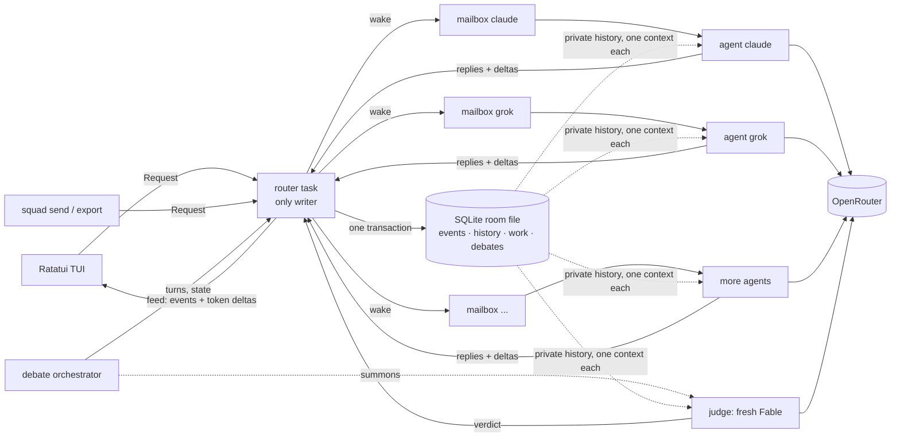

# Squad — Product Requirements Document

**Status:** draft v0.4 (fixes from two independent reviews applied; this version not yet re-verified) · **Date:** 2026-11-24 · **Repo:** https://github.com/shoemoney/squad · **Licence:** Apache-2.0

Squad is a terminal app that puts six frontier models in one chat room. It is a single self-contained
Rust binary: no server to run, no database to install. Every model call goes through OpenRouter in
parallel. You address models with `@nick` or `@all`, and a model only ever sees what was addressed to
it. When you like two answers, `$debate` makes those two models argue for `$ROUNDS` rounds, and a
summoned `@judge` scores every round and then picks the winner. Six more modes run on the same engine, and they all serve one purpose: **the ultimate plan, one where everything has been thought of.**

| Mode | What you get |
|---|---|
| `$debate` | The stronger of two ideas, and the attacks it survived |
| `$grill` | One plan, interrogated by every other model in turn and rebuilt each round |
| `$census` | What the plan is still missing, plus an estimate of how much nobody has found yet |
| `$crosscheck` | The gaps that only appear when two conditions collide |
| `$tournament` | One champion answer after blind ranking and elimination |
| `$survey` | A claim-by-claim map of what the room agrees on |
| `$probe` | A decision tree of cheap checks for a mystery |

Four of those seven were proposed by the room's own models in blind test runs.

## The canonical flow

1. `@all $debate Come up with a good use case for redis pub and sub that will go viral on github.`
   Six models answer in parallel. None of them sees another's answer.
2. The banner **`CHOOSE YOUR DEBATE BROS`** appears. You type `@grok @gemini`.
3. Grok and Gemini each get the other's idea with an adversarial brief and argue for `$ROUNDS` rounds
   (10 by default). A big ASCII banner opens each round, a fresh Fable instance scores each round as
   judge, and after the last round it returns a scored verdict.

Shortcut: if the answers already exist, `@grok @gemini $debate your solutions until $ROUNDS at which
time @judge decides which is better` skips the picking step.

## Roster (defaults; any OpenRouter model can be added, up to 12)

| Nick | Role | OpenRouter slug (verified 2026-11-24) | How "latest" resolves |
|---|---|---|---|
| `claude` | room member | `anthropic/claude-opus-5.5` | alias `~anthropic/claude-opus-latest` |
| `fable` | room member | `anthropic/claude-fable-5.2` | alias `~anthropic/claude-fable-latest` |
| `openai` | room member | `openai/gpt-6.2-sol` | alias `~openai/gpt-sol-latest` |
| `gemini` | room member | `google/gemini-4-neon` | no alias on OpenRouter: a fixed slug you bump by hand |
| `grok` | room member | `x-ai/grok-4.7` | alias `~x-ai/grok-latest` |
| `muse` | room member | `meta/muse-wonder` | no alias on OpenRouter: a fixed slug you bump by hand |
| `judge` | summoned only | same model as `fable` | same |
| `me` | the human | | |

## Shape of the product

| Decision | Choice | Why |
|---|---|---|
| Form | One Rust binary, `squad`, TUI only | Nothing to install or start besides the binary |
| TUI | Ratatui + crossterm | Redraws from state and writes only changed cells; proven on a streaming AI chat TUI (Codex CLI); 300/300 frames at about 0.7 ms each in the one independent benchmark found |
| Live traffic | In-process channels | One process, so no network hop and no broker |
| History | One local SQLite file per room | Survives restarts with zero setup |
| Isolation | Each model has its own mailbox and its own private history, and is never handed the room feed | A model cannot leak what was never delivered to it; enforced by crate boundaries (agents cannot name the store) and by a test suite |
| Debate turns | Both debaters write simultaneously each round | Symmetric, and half the wall-clock time |
| Judge | A fresh Fable instance with empty context; swaps model if `fable` is debating | No memory of the room, no stake in it, never grades its own work |
| Routing | Only the human routes messages; `quote` is the one way to show a model another's words | Six models cannot ping each other in a loop |
| Config | One `.env` file: OpenRouter key, rounds, one line per model | Nothing else to learn; adding a model is adding a line |
| Round scoring | The judge scores both debaters after every round; debaters see scores only with the verdict | A live scorecard for the human without debaters playing to the judge |
| Flair | Heavy visual effects with a frame-budget governor and `SQUAD_FX=full\|lite\|off` | The debate should feel like an event, and never at the cost of smoothness or readable text |
| Setup | `./setup.sh` installs the toolchain, creates `.env`, builds, runs `squad doctor` | Clone to running in one command |
| Money | A daily spend bar, `$spent ▰▰▱▱ $max`, with the max in `.env`; real costs from OpenRouter; hard stop at the max | You always know what today has cost |
| Licence | Apache-2.0, built in public | |
| Later | The bus sits behind a trait | A networked backend (second window, remote attach) can be added without touching the rest |

## Architecture

Each agent builds its prompt only from its own private history. The router is the only writer.

## Milestone roadmap

IDs read `M<milestone>.P<phase>.L<line item>.T<todo>`.

| Milestone | Work breakdown | Phases | Todos |
|---|---|---|---|
| **M0** | [Foundations](docs/prd/milestones/M0-foundations.md) | 4 | 51 |
| **M1** | [Protocol, store and bus](docs/prd/milestones/M1-protocol-store-and-bus.md) | 4 | 189 |
| **M2** | [Agents and OpenRouter](docs/prd/milestones/M2-agents-and-openrouter.md) | 4 | 136 |
| **M3** | [Room API and CLI](docs/prd/milestones/M3-room-api-and-cli.md) | 3 | 95 |
| **M4** | [TUI (Ratatui)](docs/prd/milestones/M4-tui-ratatui.md) | 5 | 236 |
| **M5** | [Contests (seven modes)](docs/prd/milestones/M5-contests-seven-modes.md) | 10 | 294 |
| **M6** | [Hardening](docs/prd/milestones/M6-hardening.md) | 3 | 150 |
| **M7** | [Launch](docs/prd/milestones/M7-launch.md) | 2 | 35 |
| | **Total** | | **1186** |

Build order: M0 → M1 → M2 → M3, then M4 and M5 in parallel (M4 exits after M5), then M6, then M7.
Inside M5 the modes are built in this order: debate, grill, census, crosscheck, tournament, survey, probe.

## Specification

| Section | Words |
|---|---|
| [Product overview](docs/prd/01-product-overview.md) | 10,820 |
| [Message protocol, store and bus](docs/prd/02-message-protocol-store-and-bus.md) | 20,183 |
| [Command grammar and parser](docs/prd/03-command-grammar-and-parser.md) | 11,309 |
| [Agents and OpenRouter](docs/prd/04-agents-and-openrouter.md) | 7,461 |
| [Foundations, Room API and CLI](docs/prd/05-foundations-room-api-and-cli.md) | 9,449 |
| [TUI (Ratatui)](docs/prd/06-tui-ratatui.md) | 10,949 |
| [TUI effects and motion](docs/prd/07-tui-effects-and-motion.md) | 6,580 |
| [Contests: debate, tournament, grill, census, crosscheck, survey, probe](docs/prd/08-contests-debate-tournament-grill-census-crosscheck-survey-probe.md) | 16,860 |
| [Prompt pack](docs/prd/09-prompt-pack.md) | 14,273 |
| [Hardening and launch](docs/prd/10-hardening-and-launch.md) | 8,349 |

## Also

- [Open questions](docs/prd/open-questions.md)
- [Decision log](docs/prd/decisions.md): every owner decision in order, including the ones later voided
