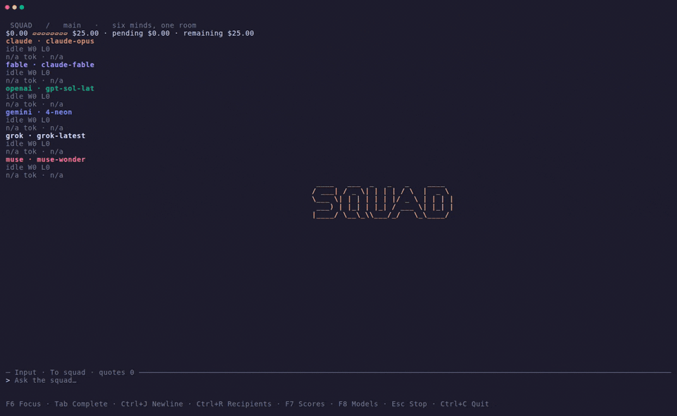
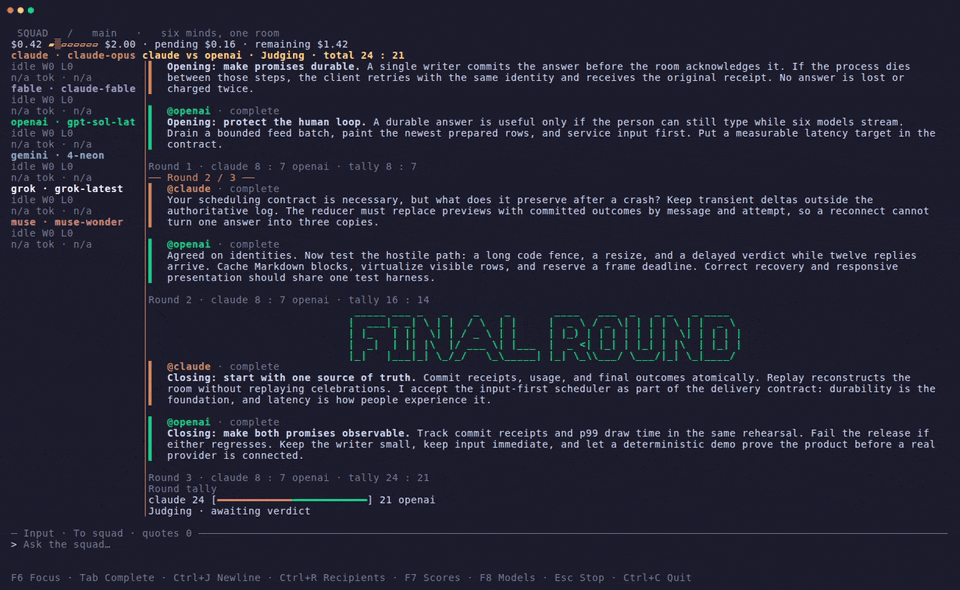
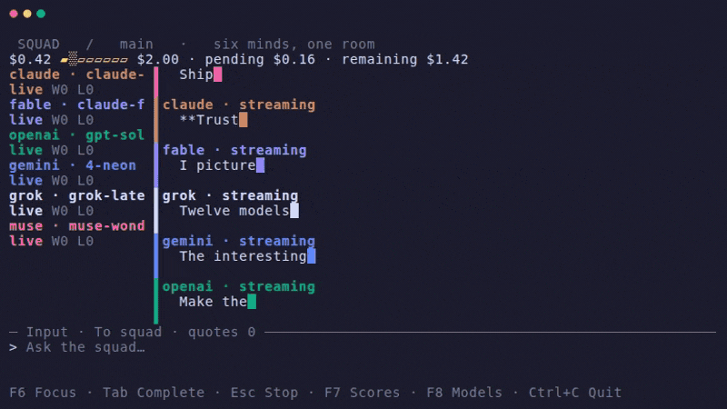
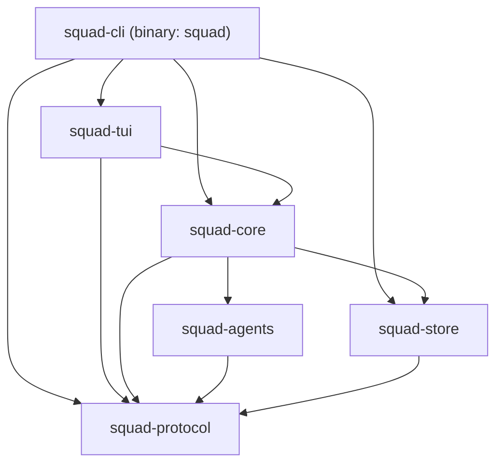
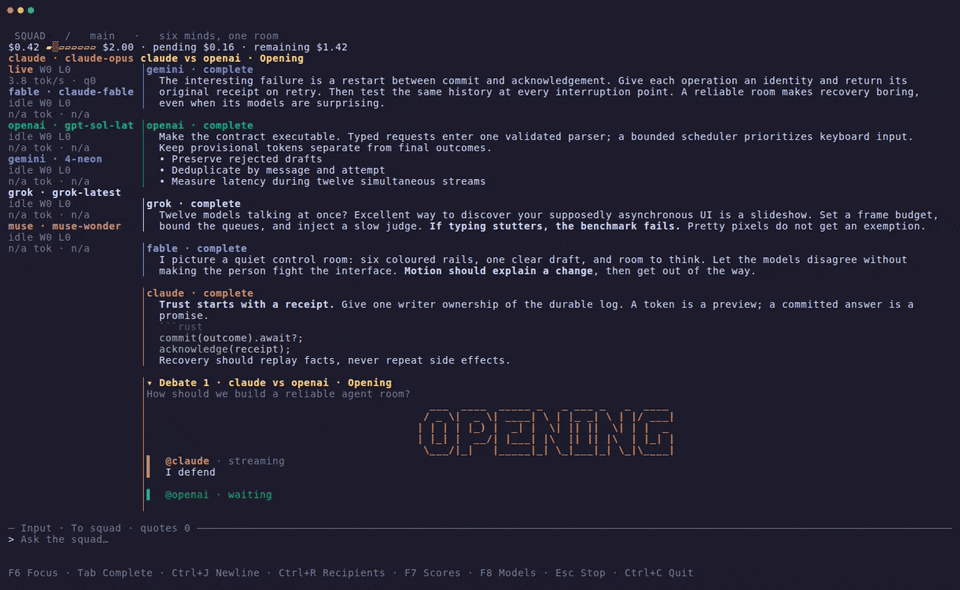
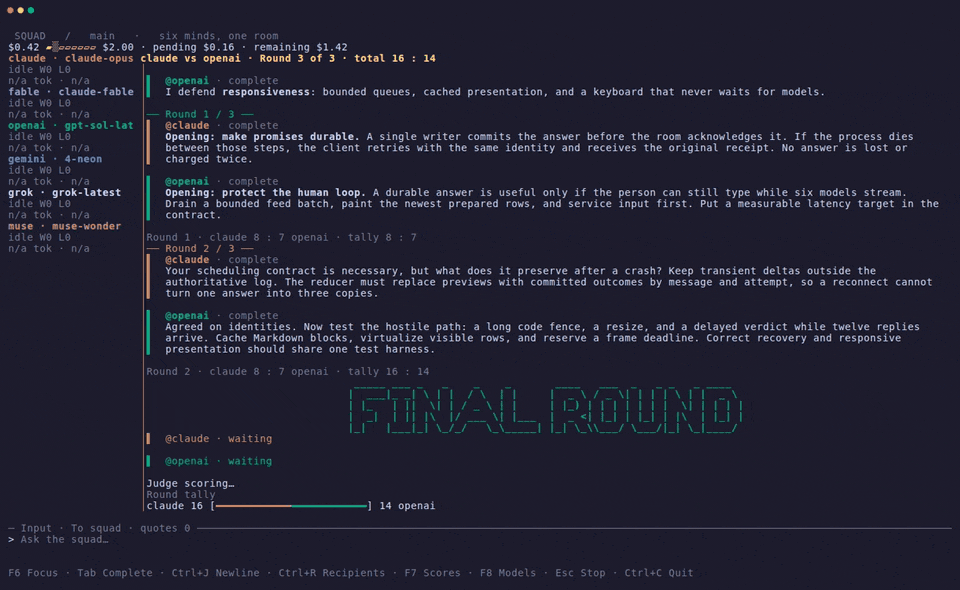
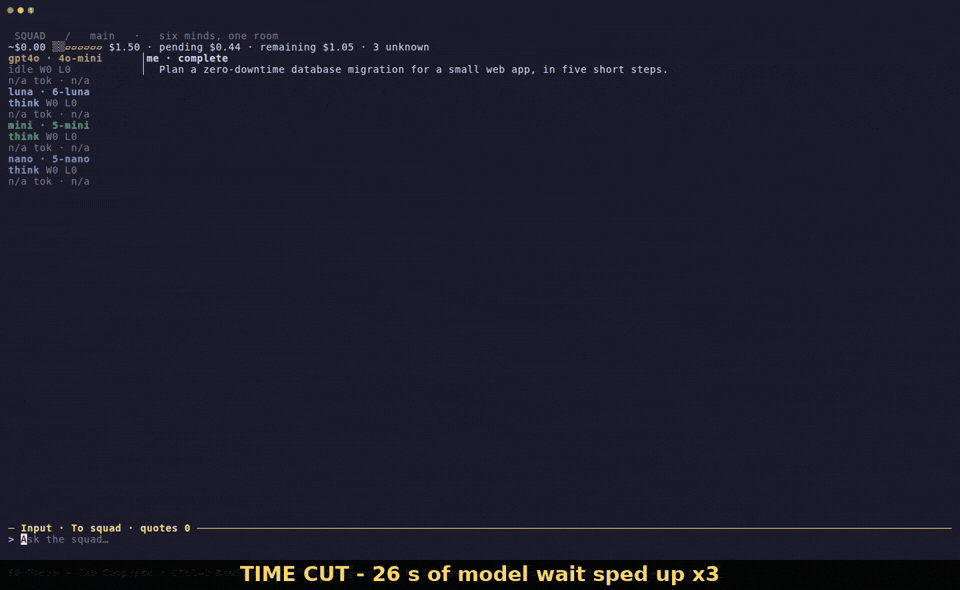
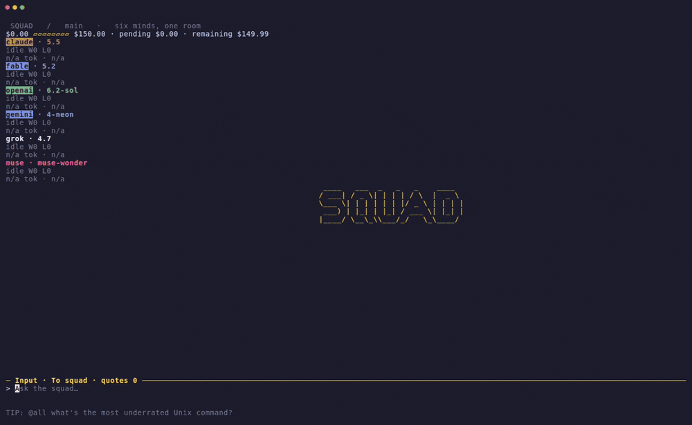

# Squad 🎙️

Six frontier models. One terminal. One room.

Squad is a terminal chat room where you talk to several LLMs at once through OpenRouter. You address them with `@nick` or `@all`, and a model only ever sees what was addressed to it. When two answers are worth a fight, `$debate` makes those two models argue it out round by round while a judge keeps score and then names a winner.

```text
@all Come up with a good use case for redis pub and sub that will go viral on github.
@grok @gemini $debate your solutions until $ROUNDS at which time @judge decides which is better
```



_The room above is the scripted rehearsal that ships with the repository, so it runs without an API key or any cost._


## 📍 Status

All seven contest modes (debate, tournament, grill, census, crosscheck, survey, probe) run end to end against OpenRouter. The workspace test suite passes, and the first live run resolved all six default seats. Release v0.1.0 is published with Linux x64 and macOS arm64 binaries and a Homebrew formula.

## 🗺️ Contents

- [🚀 Quick start](#quick-start)
- [⚙️ Configuration](#configuration)
- [💬 Using the room](#using-the-room)
- [🖥️ CLI one-shot use](#cli-one-shot-use)
- [🏗️ Architecture](#architecture)
- [🔓 Public repository](#public-repository)
- [🧪 Development checks](#development-checks)
- [🌍 Supported platforms and terminals](#supported-platforms-and-terminals)
- [🔧 Troubleshooting](#troubleshooting)
- [🔐 Optional environment variables](#optional-environment-variables)
- [🎛️ Contest modes at a glance](#contest-modes-at-a-glance)
- [🥊 Debate](#debate)
- [🏆 Tournament](#tournament)
- [🧊 Grill](#grill)
- [📋 Census](#census)
- [✅ Crosscheck](#crosscheck)
- [📊 Survey](#survey)
- [🔬 Probe](#probe)
- [🧱 Persistent `CENSUS_PASSES`](#persistent-census_passes)
- [🧩 New-mode call counts and skipped members](#new-mode-call-counts-and-skipped-members)
- [🧠 Judge effort in the new modes](#judge-effort-in-the-new-modes)
- [🔁 The shared engine](#the-shared-engine)
- [🧭 Recommended pipeline (human-directed v1)](#recommended-pipeline-human-directed-v1)
- [🧮 Estimates and preflight](#estimates-and-preflight)
- [⚖️ Judging and cases](#judging-and-cases)
- [🔒 Privacy and blind steps](#privacy-and-blind-steps)
- [🛟 Recovery after a crash or restart](#recovery-after-a-crash-or-restart)
- [🔁 Regeneration](#regeneration)
- [📤 Export](#export)
- [💾 Storage](#storage)
- [🧹 `/clear`](#clear)
- [💰 Spending: actual vs pending](#spending-actual-vs-pending)
- [🧾 How a call is priced](#how-a-call-is-priced)
- [🚧 The daily cap and `DAILY_MAX_REACHED`](#the-daily-cap-and-daily_max_reached)
- [📅 Local days and the ledger](#local-days-and-the-ledger)
- [🔍 Unknown costs](#unknown-costs)
- [🎯 Question-first picks](#question-first-picks)
- [📜 Notices](#notices)

## 🚀 Quick start

Squad runs on your machine. You bring an OpenRouter key, and Squad talks to the models for you.

From the repository root:

```bash
./setup.sh
```

The script does the boring work for you. It:

- checks for a C toolchain, `pkg-config`, `git` and `curl`, and installs what is missing,
- installs `rustup` and the pinned Rust toolchain (from `rust-toolchain.toml`) with `clippy` and `rustfmt`,
- installs `cargo-nextest` and `cargo-insta` (unless you skip them),
- creates a private `.env` from `.env.example` if you do not have one (mode `0600`),
- reports whether `OPENROUTER_API_KEY` is set,
- builds the locked release binary and runs `squad doctor`.

Re-running `./setup.sh` is safe. An existing `.env` is kept.

Then add your key to `.env`:

```bash
OPENROUTER_API_KEY=your-key-here
```

Start the room:

```bash
./target/release/squad
```

### Setup flags

| Flag | What it does |
|---|---|
| `--yes` | Runs without prompts. Lets `sudo`, the package manager and `rustup` run unattended. |
| `--runtime-only` | Skips `cargo-nextest` and `cargo-insta`. |
| `--no-build` | Skips the release build and the built-binary `doctor` check. |
| `--help` | Shows usage and exits without changing anything. |

### Other install options

Squad ships one binary, `squad`, from the `squad-cli` crate. There are three routes.

| Route | Status | Details |
|---|---|---|
| **Release binary** | Published (v0.1.0) | [GitHub Releases](https://github.com/shoemoney/squad/releases/tag/v0.1.0) has `squad-cli-aarch64-apple-darwin.tar.xz` (macOS arm64) and `squad-cli-x86_64-unknown-linux-gnu.tar.xz` (Linux x64), each with a SHA-256 checksum. Unpack it and run `squad`. |
| **Homebrew** | Published | `brew install shoemoney/tap/squad`. The formula template is `dist/homebrew/squad.rb`; `python3 dist/homebrew/render.py` fills in the version, tag and hashes. |
| **`cargo install`** | Works from a checkout | `cargo install --path crates/squad-cli --root <empty-temp-directory>` |

Check the install with:

```bash
squad --version
squad --help
```

## ⚙️ Configuration

Squad reads configuration from environment variables only. Values in an environment file are read literally. Squad never runs them through a shell, so `$` and `~` are not expanded.

### Where Squad looks

Squad loads exactly one environment file:

1. The file named by `--env-file <path>`, if you pass it.
2. Otherwise `.env` in the current directory.
3. Otherwise `squad/.env` in your config directory:
   - Linux: `$XDG_CONFIG_HOME/squad/.env` (or `~/.config/squad/.env`)
   - macOS: `~/Library/Application Support/squad/.env`

File syntax is simple. Lines look like `NAME=value`. Quotes are allowed, `#` starts a comment after whitespace, and `export` is optional.

### Precedence

**Process environment wins over the file.** A variable set in your shell replaces the file's value, even when that value is empty. `squad doctor` tells you which file it used.

### The roster

Each member is one line:

```bash
SQUAD_MODEL_<NICK>=<OpenRouter model slug>
```

- Your roster can have **1 to 12 members**.
- The nick is the lowercase form of `<NICK>`. You type it after `@`.
- A nick starts with a lowercase letter. After that it uses lowercase letters, digits and `_`, and it can be at most 32 characters.
- These nicks are reserved: `me`, `all`, `judge`, `system`, `squad`.
- If you set no `SQUAD_MODEL_*` variables at all, Squad uses the default roster below.
- A process variable with the same name replaces the file's value. Other file lines still count.

The default roster:

| Nick | Default slug | Kind |
|---|---|---|
| `claude` | `~anthropic/claude-opus-latest` | alias |
| `fable` | `~anthropic/claude-fable-latest` | alias |
| `openai` | `~openai/gpt-sol-latest` | alias |
| `gemini` | `google/gemini-4-neon` | concrete |
| `grok` | `~x-ai/grok-latest` | alias |
| `muse` | `meta/muse-wonder` | concrete |

The judge is summoned with `@judge`. It is never a room member. It is set with `SQUAD_JUDGE_MODEL` and defaults to `~anthropic/claude-fable-latest`.

### Personas and effort

| Variable | Meaning |
|---|---|
| `SQUAD_PERSONA_<NICK>` | Text added after the shared room prompt for that member. It must match a configured member. |
| `SQUAD_REASONING_EFFORT_<NICK>` | `low`, `medium` or `high` for one member. |
| `SQUAD_REASONING_EFFORT` | Default effort for all members (`medium`). |
| `SQUAD_JUDGE_REASONING_EFFORT` | Effort for final judge calls (`high`). |

### Aliases and concrete versions

A slug that starts with `~`, like `~anthropic/claude-opus-latest`, is an **alias**. Squad resolves it to a concrete model when the room starts, so it follows new releases.

A slug without `~`, like `google/gemini-4-neon`, is **concrete**. It must exist in the OpenRouter catalog. If it does not, startup fails with:

```text
Unknown OpenRouter model in SQUAD_MODEL_<NICK>: <slug>.
```

Use a concrete slug when you want the exact same model every time. Use an alias when you want the newest one.

### The alias cache

Successful alias resolutions are stored in the local SQLite database. This avoids paid probes on every start.

- The default TTL is **86400 seconds (24 hours)**. Set it with `SQUAD_ALIAS_CACHE_TTL_SECONDS`.
- An entry older than the TTL is treated as expired.
- **`0` forces a refresh** on the next model-using command. Use it once, then go back to the normal value:

  ```bash
  SQUAD_ALIAS_CACHE_TTL_SECONDS=0 squad send '@claude hello'
  ```

- Failed resolutions are never cached.
- `squad models` reads the cache only. It makes no provider calls.

### Stored `ROUNDS`, `GRILL_ROUNDS` and `CENSUS_PASSES`

These three numbers live in the room. The environment only sets them the first time.

| Stored name | Seed variable | Range | Default seed | Change it at runtime |
|---|---|---|---|---|
| `ROUNDS` | `SQUAD_ROUNDS` | 1 to 20 | `10` | `$ROUNDS=5` or `/set ROUNDS 5` |
| `GRILL_ROUNDS` | `SQUAD_GRILL_ROUNDS` | 1 to 10 | `2` | `$GRILL_ROUNDS=3` or `/set GRILL_ROUNDS 3` |
| `CENSUS_PASSES` | `SQUAD_CENSUS_PASSES` | 1 to 5 | `2` | `$CENSUS_PASSES=2` or `/set CENSUS_PASSES 2` |

The seed applies only when the room has no stored value yet. After that, the stored value wins. Editing `.env` does not change a room that already has a value. Change the value in the room instead.

## 💬 Using the room

The room has a participants list on the left and the conversation on the right. `F7` opens scores and reasons on a verdict, and `F8` opens the participants panel.



The room runs in as little as 80x24 (its minimum). The layout narrows, and the key hints stay at the bottom.



### Addressing

| You type | What happens |
|---|---|
| `@claude hello` | Sends the message to `claude` only. |
| `@grok @gemini compare these` | Sends to both. |
| `@all what do you think?` | Sends to every member. |
| `@all -grok what do you think?` | Sends to everyone except `grok`. |
| `@judge` | Summons the judge. |

Nicks are lowercase. `@Claude` is an error, and Squad never changes the case for you. A model only sees what was addressed to it.

**Escaping:** type `\@claude` to get the literal text `@claude`. Text inside backticks is also protected, and so is text inside a fenced code block. An email address like `you@example.com` is plain text on its own.

**Attached quotes:** on the CLI, `--quote <seq>` attaches a committed message by its sequence number. In the TUI, move focus to the room with `F6`, then use `Up` / `Down` to pick a message, `Space` to select more than one, and `Enter` twice to quote (the first `Enter` opens the action menu, the second runs **Quote**). Attached quotes show above the input, and `Esc` removes them.

### Commands

Commands start with `$` (contests) or `/` (room controls). `$` commands are only recognized in a message. A slash command uses the whole message.

| Command | Purpose |
|---|---|
| `$debate` | Structured argument between two members, with a judge. |
| `$grill` | One member is grilled on a plan by the others. |
| `$tournament` | Entrants compete and the room judges the winner. |
| `$census` | Blind hunt for omissions in a plan. |
| `$crosscheck` | Independent coverage grid for a pasted plan. |
| `$survey` | Claims and votes on one question, with a report. |
| `$probe` | Predictions and a decision tree for a question. |
| `/help` | Shows the grammar and examples. Makes no model call. |
| `/who` | Shows the roster, resolved models and records. |
| `/set NAME value` | Changes `ROUNDS`, `GRILL_ROUNDS` or `CENSUS_PASSES` in the room. |
| `/stop` or `/stop @nick` | Stops all work, or one member's work. |
| `/export <scope> [id]` | Writes a Markdown export. Scopes: `room`, `debate`, `grill`, `tournament`, `census`, `crosscheck`, `survey`, `probe`. |
| `/clear` | **Wipes the stored room.** It is not a display-only action. |

Each mode has its own rules and cost preview. Those are covered in the mode sections of this README.

### Question-first and the direct `$debate` shortcut

There are two ways to start a debate.

**Direct debate.** Name exactly two members and add `$debate`. Squad goes straight to the debate, with no question step.

```text
@grok @gemini $debate
@grok @gemini $debate Compare these @judge
```

A direct debate needs exactly two distinct explicit members, and no `@all`. Add `@judge` to request judging.

**Question-first debate.** Use `@all`, or three or more named members, with a question. Squad does this in three steps:

1. **Answer.** Each candidate answers your question privately. Their replies are mutually invisible. These calls count toward your daily spend, like any normal reply.
2. **Pick.** After everyone has answered, the room shows the pick banner. Name exactly two of the eligible members:

   ```text
   @grok @gemini
   ```

   A wrong pick does not cancel the pick. Squad tells you what to fix, for example `Pick exactly two of: @grok, @gemini, @claude.` You can also send ordinary messages while the pick is pending.
3. **Confirm.** Squad shows a cost preview for the debate. Press `y` to start it or `n` to cancel. Use `--yes` to confirm from the CLI.

```text
@all $debate Which cache should we use for pub/sub?
```

Question-first grills work the same way. Pick one member to be grilled.

### Keyboard (TUI)

The bottom bar shows the most useful keys for your terminal width.

| Key | What it does |
|---|---|
| `Enter` | Sends the message. |
| `Ctrl+J`, `Alt+Enter` (or `Shift+Enter` in kitty-protocol terminals) | Inserts a new line. |
| `Tab` | Opens completion, or accepts the selected item. |
| `Up` / `Down` | Moves through open completion. With focus on the room, moves between messages. |
| `Space` | With focus on the room, selects or deselects the focused message for quoting. |
| `Ctrl+R` | Inserts the last recipients. |
| `Alt+Up` / `Alt+Down` | Moves through input history. |
| `Ctrl+A` | Selects all input. |
| `F5` | Collapses or expands crosscheck cell details. |
| `F6` | Switches focus between the room and your input. |
| `F7` | Shows or hides scores, verdicts and the probe prediction matrix. |
| `F8` | Shows or hides the participants panel. While it is open, `Up` / `Down` move through it. |
| `F12` | Shows or hides the debug overlay. |
| `PageUp` / `PageDown` | Scrolls the room. |
| `Ctrl+F` | Opens or closes search over the loaded transcript. While open, `Enter` / `Down` go to the next match, `Shift+Enter` / `Up` to the previous, `Esc` closes. |
| `Ctrl+Y` | Copies the selected or focused messages to the clipboard (OSC 52). |
| `End` | Jumps back to live. |
| `Enter` (room focused) | Opens the message action menu. `Enter` again quotes the selected messages (or the focused one). |
| `y` / `n` | Confirms or cancels a pending cost preview. |
| `r` (room focused) | Regenerates the focused member reply, or the latest reply when none is focused. |
| `t` (room focused) | Retries the focused reply's failed or cancelled work item. Siblings are not restarted. |
| `x` (room focused) | Stops only the focused reply's member. |
| `Esc` | Closes the topmost open panel first. Then it cancels a pending cost preview, or clears attached quotes. After that it stops work. During a contest, press `Esc` twice within 2 seconds. |
| `q` | Quits, when focus is not in the input. |
| `Ctrl+C` | Quits. |

## 🖥️ CLI one-shot use

Besides the room, `squad` has a few commands you can run from a script.

### `squad send`

```text
squad send "<message>" [--quote <seq>...] [--yes] [--json] [--verbose] [--no-wait]
```

Squad opens the room in one-shot mode, sends one message, waits for the work to finish, and exits.

| Flag | What it does |
|---|---|
| `--quote <seq>` | Attaches a committed message by sequence number. Repeat it, or use commas: `--quote 12 --quote 14` or `--quote 12,14`. Up to 12. |
| `--yes` | Confirms the cost preview automatically. Needed when you are not at a terminal to answer the prompt. |
| `--json` | Writes JSON lines to stdout. Diagnostics go to stderr. |
| `--verbose` | Prints raw accounting updates instead of call summaries. |
| `--no-wait` | Commits the work, prints the cursor, and exits without calling any model. |

Plain output labels each reply with its nick. It ends with a usage line, for example:

```text
Usage: 3 calls; known cost $0.012345; unknown-cost calls: 0
```

**Cost confirmation.** If a plan is above the threshold and you run it in a terminal, Squad asks `Confirm plan? [y/N]`. Without a terminal and without `--yes`, Squad exits with `Confirmation required. Re-run with --yes in noninteractive mode.` The refused plan is cancelled, nothing is admitted or generated, and the `--yes` re-run starts clean.

**`--bus-log <file>`.** Writes one JSON line per bus request, commit and mailbox wake-up to `<file>` (created with owner-only permissions, replaced on each run). Message bodies are redacted. Add `--bus-log-bodies` to also record the human-visible text of user messages and model replies as `body` lines; credentials, authorization headers, reasoning text and internal prompts are never written. `--bus-log-bodies` requires `--bus-log`. `squad doctor --bus-log` creates an empty file, since doctor does not open the room.

**`--no-wait`.** The message is saved and gets a cursor, but no model is called yet. The work waits until the next interactive open. Plain output says `Accepted (cursor N).` With `--json`, the `ack` record includes `cursor`.

**JSON records.** Each line is an object with a `type`. The common types are:

| `type` | When |
|---|---|
| `ack` | Work was accepted. Includes `requestId`, `eventIds`, and `cursor` when available. |
| `event` | A committed event relevant to your request. Includes `cursor` and `event`. |
| `usage.total` | Totals at the end: `calls`, `knownCostUsd`, `unknownCostCalls`. |
| `command.result` | Result of `/help` or `/who`. |
| `export.ready` | An export file was written. |
| `error` | A failure. Includes `error.code`, `error.message` and `error.retryable`. |
| `*.preflight` and `*.cancelled` | Cost previews and cancellations, for example `debate.preflight` and `contest.cancelled`. |

### Recovery and one-shot behaviour

- An interactive open resumes unfinished work that it can recover.
- A one-shot `send` **never resumes unrelated unfinished work**. It only waits for the work it created.
- A `send` without `--no-wait` waits for every addressed member to finish. If one member fails, the others still finish.

### `squad models`

Prints the resolved roster from the local cache, in roster order:

```text
claude (member): ~anthropic/claude-opus-latest -> <concrete model>
```

It does not open the room and makes no billed probes. If nothing is cached yet, it says `No startup snapshot. Open the room to resolve models.`

### `squad doctor`

```text
squad doctor [--env] [--online]
```

| Flag | What it does |
|---|---|
| (none) | Offline checks: configuration, credential presence, data directory, terminal, cost accounting, storage use, and cached model resolution. Makes no network calls. |
| `--online` | Adds two free checks: OpenRouter reachability (`models`) and key validity (`key`). It never generates text. |
| `--env` | Also prints every supported variable with its default and meaning. |

`doctor` does not open the room. It prints a `Storage: <used> MiB used of 1024.0 MiB (<percent>%)` line, read-only from the database, and adds `WARNING - near the ceiling` from 90% and `WARNING - at the ceiling` at the limit. A storage warning does not fail doctor. It ends with `Overall: PASS` or `Overall: FAIL`. A failed required check exits with code 1.

### Exit codes

| Code | Meaning |
|---|---|
| `0` | Success. |
| `1` | A configuration, provider, execution, confirmation, export, storage or diagnostic failure. A waiting `send` also exits 1 if any addressed member ends in a terminal failure. |
| `2` | Invalid command-line syntax or flags. |
| `130` | Interrupted with Ctrl+C, after cleanup. |

## 🏗️ Architecture

Squad is a Cargo workspace of six crates. Each crate has one job, and the table shows the `[dependencies]` edges from each crate's `Cargo.toml`. Dev-only links are left out.

| Crate | What it does | Depends on |
|---|---|---|
| `squad-protocol` | Wire types: envelopes, work, errors, config and the command parser. | Nothing in the workspace |
| `squad-store` | SQLite store: schema, migrations and the transactional commit API. | `squad-protocol` |
| `squad-agents` | Agent executors: OpenRouter client, model registry and context-bound workers. | `squad-protocol` only, so it never sees the store or `rusqlite` |
| `squad-core` | Bus, router, contest engine, prompts, export and the room handle. | `squad-protocol`, `squad-store`, `squad-agents` |
| `squad-tui` | Terminal UI built on Ratatui. | `squad-protocol`, `squad-core` |
| `squad-cli` | The `squad` binary: argument parsing, one-shot commands, `doctor`, `models` and export. | `squad-protocol`, `squad-core`, `squad-store`, `squad-tui` |



## 🔓 Public repository

Squad is public. The repository is `github.com/shoemoney/squad`, and it has been built in public from day one under decision **D61**. The code is licensed under Apache-2.0.

Publishing release artifacts is a separate step. Binaries and packages go out only when the owner explicitly authorizes it, which is the M7 launch decision. Until then, build from source as shown in [Quick start](#quick-start).

## 🧪 Development checks

CI runs these on macOS and Ubuntu. Run them from the repository root. Use the pinned toolchain from `rust-toolchain.toml`.

```bash
cargo fmt --all -- --check
cargo clippy --workspace --all-targets --locked -- -D warnings
cargo build --workspace --locked
cargo test --workspace --locked
cargo nextest run --workspace --locked
cargo test --workspace --doc --locked
shellcheck setup.sh scripts/*.sh
./scripts/test-setup.sh
```

`./scripts/test-setup.sh` runs the installer against a closed `PATH` with mock tools. It checks that the installer does not change the host.

The workspace denies `unsafe` code and treats Clippy warnings as errors.

`crates/squad-cli/tests/pty.rs` runs the real `squad` binary in a pseudo-terminal against a loopback OpenRouter fixture. It covers a streamed `@all` round trip, Ctrl+C and SIGINT exits, terminal restoration (alternate screen, cursor, mouse, paste and raw mode), a hangup during a streaming reply followed by recovery on the next start, the missing-key message, the too-small terminal screen and `NO_COLOR`. It needs no network and no real key. Run it alone with `cargo test -p squad-cli --test pty`. It is Unix-only.

## 🌍 Supported platforms and terminals

Squad's effects (banners, the verdict reveal, motion in the room) scale down with your terminal and `NO_COLOR`. This is the effects reel from the repository, recorded in a full-colour terminal.


| Platform | Setup route |
|---|---|
| macOS arm64 | Homebrew. Xcode Command Line Tools are required. |
| Linux x64 | `apt-get` or `dnf`. |

`./setup.sh` stops with a clear message on any other platform.

Terminal requirements:

- At least **80 columns by 24 rows**. Smaller windows show `Terminal too small` until you resize.
- `TERM` must be set and must not be `dumb`.
- Colour follows `NO_COLOR`, `COLORTERM` and `TERM`. `squad doctor` reports the colour level and the terminal size.
- With `NO_COLOR` set, the room draws no foreground or background colours.
- Ctrl+C inside the room quits and exits `0`. A SIGINT sent to the process exits `130`. Both leave the alternate screen, show the cursor and turn raw mode off.
- A terminal that closes mid-reply sends SIGHUP, which ends the process without a clean room shutdown. The unfinished replies stay queued in the database, and the next start runs them again.

## 🔧 Troubleshooting

| You see | What to do |
|---|---|
| `OPENROUTER_API_KEY is required. Add it to .env or the process environment.` | Add the key to `.env`, or export it in your shell. Remember that a process variable wins over the file. |
| `Configure 1 to 12 members with SQUAD_MODEL_<NICK>.` | Add at least one `SQUAD_MODEL_*` line, and no more than 12. |
| `Invalid member nick...` or `Reserved member nick...` | Use a lowercase nick that is not `me`, `all`, `judge`, `system` or `squad`. |
| `Unknown OpenRouter model in SQUAD_MODEL_<NICK>: <slug>.` | Check the slug in OpenRouter, or use a `~` alias. |
| `Room main is already open in another squad process (pid N).` | Another Squad is using the room. Close it. `squad export` still works while the room is open. |
| `Data directory is not writable: <path>.` | Fix the permissions, or point `SQUAD_DATA_DIR` or `--data-dir` somewhere writable. |
| `Daily max of $X reached. Raise SQUAD_DAILY_MAX_USD or wait until tomorrow. (Spent $S today; this request needs up to $Z reserved.)` | Today's spend plus the reservation would pass `SQUAD_DAILY_MAX_USD`. Use a cheaper setting, or raise the cap. |
| `Confirmation required. Re-run with --yes in noninteractive mode.` | Add `--yes`, or run the command in a terminal. |
| `Cannot read environment file: <path>.` | Check the file exists and is readable. |
| `Terminal too small: WxH. Required: 80×24.` | Resize the terminal window. |

Run `squad doctor` first. It checks most of these in one place.

Logs are written to `<data directory>/logs/squad.jsonl`. The file is created with mode `0600`. Use `SQUAD_LOG_LEVEL=debug` for more detail.

## 🔐 Optional environment variables

Every variable below is optional, except `OPENROUTER_API_KEY`. Run `squad doctor --env` to see the same table, along with the values in effect.

| Variable | Default | Meaning |
|---|---|---|
| `OPENROUTER_API_KEY` | None (required) | Your OpenRouter key. Never displayed. |
| `OPENROUTER_BASE_URL` | `https://openrouter.ai/api/v1/` | API base URL. Keep the trailing slash. |
| `SQUAD_MODEL_<NICK>` | Six defaults above, when none are set | One roster member per variable. |
| `SQUAD_JUDGE_MODEL` | `~anthropic/claude-fable-latest` | The summoned judge model. It is never a room member. |
| `SQUAD_JUDGE_FALLBACKS` | `claude,openai` | Ordered fallback nicks when the judge model conflicts with a debate. Only checked against the roster when set explicitly. |
| `SQUAD_JUDGE_REASONING_EFFORT` | `high` | `low`, `medium` or `high` for final judge calls. |
| `SQUAD_PERSONA_<NICK>` | Empty | Persona text for one member. |
| `SQUAD_REASONING_EFFORT` | `medium` | `low`, `medium` or `high` for members. |
| `SQUAD_REASONING_EFFORT_<NICK>` | Unset | Effort override for one member. |
| `SQUAD_USER_NAME` | `the user` | Name given to prompts. You are still `me` in the interface. Must not be empty. |
| `SQUAD_ROUNDS` | `10` | Seeds the stored `ROUNDS` (1 to 20) when none is stored. |
| `SQUAD_GRILL_ROUNDS` | `2` | Seeds the stored `GRILL_ROUNDS` (1 to 10) when none is stored. |
| `SQUAD_CENSUS_PASSES` | `2` | Seeds the stored `CENSUS_PASSES` (1 to 5) when none is stored. |
| `SQUAD_DAILY_MAX_USD` | `150` | Daily spending cap in US dollars. Must be a positive number. |
| `SQUAD_DEBATE_CONFIRM_USD` | `2` | Estimated cost above which Squad asks you to confirm. `0` or more. |
| `SQUAD_ALIAS_CACHE_TTL_SECONDS` | `86400` | How long alias resolutions are reused, in seconds. `0` forces a refresh. |
| `SQUAD_ROOM_WORDS` | `500` | Word limit for the room prompt. Must be a positive integer. |
| `SQUAD_TURN_WORDS` | `400` | Word limit for debate turns and grill answers. |
| `SQUAD_FINAL_TURN_WORDS` | `500` | Word limit for the final debate turn. |
| `SQUAD_PLAN_WORDS` | `1200` | Word limit for rebuilt grill plans. |
| `SQUAD_PROMPTS_DIR` | Unset (built-in prompts) | Directory of prompt templates to use instead of the built-in ones. The built-in pack lives in `crates/squad-core/prompts` and ships inside the `squad-core` package. |
| `SQUAD_DATA_DIR` | Linux: `~/.local/share/squad` (or `$XDG_DATA_HOME/squad`). macOS: `~/Library/Application Support/squad` | Where the database, cache and logs live. `--data-dir` overrides it. |
| `SQUAD_LOG_LEVEL` | `info` | `trace`, `debug`, `info`, `warn`, `error` or `off`. |
| `NO_COLOR` | Unset | Any non-empty value turns colour off. |
| `SQUAD_BANNERS` | `on` | `on`, `compact` or `off` for contest banners. |
| `SQUAD_FX` | `full` | Animation level: `full`, `lite` or `off`. `lite` is picked automatically only when this is unset. |
| `SQUAD_FX_DEBUG` | Unset | Set to `1` to show the effects-grade tag. |

These are read from the environment, but they are not Squad settings:

| Variable | Used for |
|---|---|
| `HOME`, `XDG_CONFIG_HOME`, `XDG_DATA_HOME`, `APPDATA`, `LOCALAPPDATA` | Locating the config and data directories. |
| `TERM`, `COLORTERM`, `SSH_TTY`, `TMUX` | Choosing colour and animation behaviour in the TUI. |

Benchmark-only variables, read by `cargo bench` and not used by the app:

| Variable | Default | Meaning |
|---|---|---|
| `COMPOSED_ENFORCE` | Enforced | Set to `0` to report the composed-stream gate without failing. |
| `COMPOSED_SECS` | `300` | Seconds per run of the composed-stream benchmark. |
| `SPIKE_SECS` | `300` | Seconds per viewport in the twelve-stream benchmark. Must be positive. |
| `SPIKE_TERMINAL` | Unset | Set to `1` to draw to a real terminal (120×36 or larger). |

## 🎛️ Contest modes at a glance

Squad has **seven contest modes**. Each one is a script that runs on the same shared engine, and **only one contest can run per room at a time**.

| Mode | Start with | What it's for | Blind steps? | Normal model calls | Ends with | Export |
|---|---|---|---|---|---|---|
| 🥊 Debate | `@a @b $debate <question>` | Two members argue a question, optionally scored by a judge | No | `2 × (R + opening) + (judge ? R + 1 : 0)` | Report, plus a verdict when a judge was asked for | `/export debate [id]` |
| 🏆 Tournament | `@a @b @c $tournament <prompt>` | Entrants answer; a blind judge eliminates one entrant per round | Yes (judge) | `Σ(n + 1)` for n = 2…k | Champion and placings | `/export tournament [id]` |
| 🧊 Grill | `@leader $grill [focus]` | Grillers challenge a leader's plan; the leader rebuilds it each round | No (shared floor) | `R × (2G + 1)` | Final plan and Q&A appendix | `/export grill [id]` |
| 📋 Census | `@all $census` plus a plan | Members hunt for omissions, rate them anonymously, and estimate what's still unfound | Yes | `passes × (2m + 2)` | Census report for each pass | `/export census [id]` |
| ✅ Crosscheck | `@all $crosscheck <plan>` plus a `--` goal | Plan-blind inventory, a cell-by-cell review, and audits | Yes | `2m + 4 + e` | Coverage ledger and bounded-stop status | `/export crosscheck [id]` |
| 📊 Survey | `@all $survey <question>` or `@all $survey` | Members vote on claims; the report sorts them into five bands | Yes (votes and revotes) | `3m + 2` new, `2m + 2` reusing answers | Claim map by band | `/export survey [id]` |
| 🔬 Probe | `@a @b @c @d $probe <brief>` | Explainers and checkers propose; explainers commit predictions; a decision tree of cheap checks | Yes | `3m/2 + 1` (m even) | Decision tree and prediction matrix | `/export probe [id]` |

**Key:** m = members in the contest, G = grillers, R = rounds, k = entrants, e = 1 when crosscheck must first extract a goal (no `--` goal given), otherwise 0. "Blind" means members or a judge get anonymised material.

> 💡 **Rule of thumb:** no blind steps means the members see each other's words. Blind steps mean nobody can tell who said what.

---

## 🥊 Debate

### 🎯 What it's for




_Both clips are the scripted rehearsal that ships with the repository._

Two members argue a question in turns. Add `@judge` to score each round and get a final verdict.

### ▶️ How to start
```text
@grok @gemini $debate Compare these two approaches @judge
@grok @gemini $debate
```
- A direct debate needs **exactly two** recipients. Anything else is refused.
- With `@all` or three or more named members plus a question, Squad runs a **question-first pick** first. Each member answers, then you send only `@nick @nick` to choose the two debaters.
- `@judge` asks for judging.

### 🔄 What happens
1. **Opening round (round 0):** both debaters answer the question. This happens when no solutions were picked.
2. **Rounds 1 to R:** each debater takes a turn. The final round uses the final-turn word limit. `ROUNDS` defaults to **10** and can be 1 to 20.
3. **If judged:** after each round the judge scores it, then a final judge gives the verdict.
4. **Report.**

Debate has no blind-judging or anonymising step in its script, so the blind-step rules in the sections below don't apply to it.

### 🔢 Calls and cost

| Item | Formula | Example: direct debate, 10 rounds, judged |
|---|---|---|
| Planned calls | `2 × (R + opening) + (judge ? R + 1 : 0)` | **33** |
| Reserved attempts | `4 × (R + opening) + (judge ? 2R + 3 : 0)` | **67** |
| Judge-only rerun (`/judge [debateId]`) | 1 planned call | 3 reserved attempts |

- A debate turn gets 2 attempts, then the turn is **forfeited**.
- A round judge gets 2 attempts, then the round is **unscored**.
- A final judge gets 3 attempts, including one repair.

### 🏁 How it ends
The debate reports after the last turn, or after the final verdict when judged. `/judge [debateId]` reruns only the judge on a finished debate. The earlier terminal state is kept so the rerun can roll back.

### 🛑 Stop
`/stop` ends the debate. Stopping cancels queued and running work for it and releases the room's claim. `/stop @nick` applies only if that nick is one of the debaters.

### 📄 Report and export
The report has the setup, every turn (including forfeits), the per-round scores, and the verdict.

```text
/export debate [id]
```

---

## 🏆 Tournament

### 🎯 What it's for


_Time cuts: model waits are sped up and each cut is labelled on screen. Recorded with the v0.1.0 release binary on low-cost models; the complete recordings are described in [docs/demo.md](docs/demo.md)._

A knockout. Entrants answer, a blind judge ranks them, and the lowest-ranked entrant goes out each round until one champion remains.

### ▶️ How to start
```text
@all $tournament Design a useful CLI
@grok @gemini @claude $tournament Design a useful CLI
```
- At least **three** entrants, and a prompt is required.
- There is **no pick step**.

### 🔄 What happens
1. **Round 1:** every entrant answers in parallel. You see every answer. Entrants only ever see the setup prompt and their own results.
2. **Blind judging:** the judge gets the prompt and the answers under anonymous labels (A, B, C, …). The labels are shuffled each round. Nicks, model names and personas are replaced with `[redacted]`. The judge runs at high reasoning effort.
3. **Ranking:** the judge must rank **every** label exactly once, with an integer score from 1 to 10 and a one-line critique for each.
4. **Forfeits:** an entrant with no usable answer is recorded as a **forfeit**. Forfeits are ranked below every answering entrant, so they are eliminated first.
5. **Elimination:** the last-ranked entrant is eliminated. Each entrant's own result (rank, score, critique, and whether it survived) goes only to that entrant and to you.
6. **Next round:** survivors answer again, with their own previous result in their history.
7. **Invalid verdict:** if the judge's ranking is invalid after its attempts, the round is **replayed once**. If the replay also fails, the tournament fails with `JUDGE_INVALID_VERDICT`.

### 🔢 Calls and cost
With **k** entrants there are **k − 1** rounds.

| Item | Formula | 3 entrants | 6 entrants |
|---|---|---|---|
| Normal calls | `Σ(n + 1)` for n = 2…k (answers plus one judge per round) | **7** | **25** (20 answers + 5 judgings) |
| Reserved attempts | `Σ 2(2n + 3)` for n = 2…k (room for one replay of every round) | **32** | **110** |

- Entrants get **2 attempts** per round.
- The judge gets **3 attempts**, including one repair.
- The estimate includes the one replay per round.

### 🏁 How it ends
When one survivor is left, that entrant is the **champion**. Their trophy count goes up by one, and no wins or losses change. The placings list puts the champion first and then the eliminated entrants in reverse order of elimination. Each placed entrant receives the final placings.

### 🛑 Stop
`/stop` stops the whole tournament. `/stop @nick` applies only while that nick is still a survivor.

### 📄 Report and export
The export has the setup (prompt, entrants, judge model, rounds), each answer, each accepted ranking with scores and critiques, each elimination with its placing, and the champion with the trophy count.

```text
/export tournament [id]
```

---

## 🧊 Grill

### 🎯 What it's for


_Time cuts: model waits are sped up and each cut is labelled on screen. Recorded with the v0.1.0 release binary on low-cost models; the complete recordings are described in [docs/demo.md](docs/demo.md)._

Stress-test a plan. Grillers question the leader, the leader answers and revises, and the plan is rebuilt after every round.

### ▶️ How to start
```text
@grok $grill
@grok @claude @gemini $grill
@grok $grill Focus on the rollout risks
@all $grill Design a backup plan
```
- **`@leader $grill`** uses the leader's **latest reply** as the first plan. Every other roster member becomes a griller. If the leader hasn't replied yet, Squad refuses with "No plan to grill".
- **`@leader @g1 @g2 $grill`** limits the grillers to the names you list.
- **`@all`** or two or more named members plus text starts with answer collection. Then you pick one leader by sending only `@nick`.
- Judges are not allowed in a grill (`@judge` is refused).

### 🔄 What happens (shared floor)
Each round has these steps. `GRILL_ROUNDS` defaults to **2** and can be 1 to 10.

1. **Griller turn:** the griller asks **one to three questions** (200 words total at most), or replies with exactly `PASS`. Each question carries an angle (cost, failure modes, security, scale, edge cases, hidden assumptions, user experience, or operations). A question can't repeat an earlier one.
2. **Leader answer:** for each question, the leader gives an answer and the concrete plan changes it implies.
3. **Next griller:** the same cycle runs for each griller in order.
4. **Rebuild:** after every griller has had a turn, the leader rebuilds the full plan. Each rebuild creates a new **plan version**. The griller order rotates by one for the next round.

**Who sees what:** the leader and every griller see every question, answer, pass and plan version on the shared floor. Members outside the grill see none of it.

**Plan versions:** version 1 is the starting plan, and each rebuild adds one.

**PASS:** a voluntary pass. If every griller passes in one round, with no questions asked, the grill completes early with reason `survived`.

**Failure handling:**
- If a griller **fails or times out**, Squad records an automatic pass. This is **not** a voluntary PASS, so it doesn't count toward `survived`, and the round carries on.
- If the **leader fails** while answering or rebuilding, the grill fails with `leader_failed`.

### 🔢 Calls and cost
Normal calls are **`R × (2G + 1)`**: each griller asks once per round, the leader answers once per griller, and the leader rebuilds once. For example, 5 grillers and 2 rounds give **22** calls.

Each planned call reserves **twice** its own bounded cost (two attempts, each priced from the shared floor it can see at that point). Each member call gets 2 attempts, with the second issued by Squad, and a 180-second deadline.

### 🏁 How it ends
- After the last round's rebuild, the grill completes with reason `rounds_complete`.
- Other end reasons: `survived` (an all-pass round), `grillers_exhausted` (the final round ended with no questions and not everyone passed), `stopped`, and `leader_failed`.

### 🛑 Stop
`/stop` stops the grill with reason `stopped`. If you stop it during preflight, it is cancelled before any money is reserved. `/stop @nick` applies only if that nick is a participant.

### 📄 Report and export
The grill has no judge and no winner. The result is the **final plan** and an **appendix**: every question with its answer and plan changes, with missing answers left as missing. The export also has every plan version, every pass, and the round structure.

```text
/export grill [id]
```

---

## 📋 Census

### 🎯 What it's for


_Time cuts: model waits are sped up and each cut is labelled on screen. Recorded with the v0.1.0 release binary on low-cost models; the complete recordings are described in [docs/demo.md](docs/demo.md)._ In this run one member reply was rejected as invalid, so the estimate line reads "Estimate unavailable".

Find omissions in a plan. Members hunt blind, the judge merges and the members rate anonymously, and the report estimates what's still unfound.

### ▶️ How to start
```text
@all $census                 (quote one plan message first)
@all $census <plan text>     (paste the plan instead)
@grok $census                (plan = grok's latest reply; the whole roster takes part)
```
- Give **exactly one** plan source: quote one member reply or one grill plan version, paste the text, or name one member for their latest reply. Quoting and pasting together is refused.
- Needs **at least three** members, and at most 12.
- A single named member with no text uses the whole roster.

### 🔄 What happens (each pass)
1. **Hunt (members, parallel):** each member gets the plan and **one lens**. It lists **up to 8** omissions, each with its consequence. Members never see other members' finds.
2. **Merge (judge):** duplicate finds are merged into a ledger of **up to 96** gaps. Each gap keeps every source find, exactly once, and the lenses behind it.
3. **Rate (members, parallel):** each member rates **every** ledger gap as `real`, `covered` (the rating must quote the plan exactly), or `trivial`. Members may also add **up to 8** new gaps.
4. **Finalise (judge):** the judge assigns each gap a disposition and a priority, and merges the additions. The judge **cannot overrule the majority** that the app computes.
5. **Report (app):** tallies, finder counts, dispositions and the estimate come from the app, not from the judge's prose.

**Lenses:** the six lenses are stakeholders, failure modes, dependencies and sequencing, hidden assumptions, external and legal factors, and the day after success. Each member gets one lens per pass from a random, persisted assignment, and the lens rotates each pass.

**Who sees what:**

| Step | Who gets it | What they don't get |
|---|---|---|
| Hunt | One member | Other members' finds |
| Merge | Judge | Who found each gap (finds carry only ids and lenses) |
| Rate | Each member | Lenses, sources, finder counts, or names |
| Finalise | Judge | Finder names and counts, and the missing list |

**Dispositions:** only accepted ballots vote, and missing ballots never vote.
- A majority of covered or trivial ballots drops the gap to **Covered** or **Trivial**.
- Without a majority, a gap is **Confirmed** only if everyone voted, and **Unresolved** otherwise.

**Finder counts:** the number of distinct members whose hunts produced the gap.

**Estimate:** Chao1 over the confirmed gaps.
- `f1` = gaps found by exactly one member (**singletons**).
- `f2` = gaps found by exactly two members.
- `U = f1² / (2 · f2)` when `f2 > 0`, otherwise `U = f1 · (f1 − 1) / 2`.

The report shows `f1`, `f2`, which formula branch was used, the unrounded `U`, and the input gap ids.

**Estimate range and caveat:** the report shows `Found {n}; estimated {lo} to {hi} still unfound.` with both numbers rounded to one decimal. The range is the Chao (1987) log-normal interval around `U`: with variance `f2·[½(f1/f2)² + (f1/f2)³ + ¼(f1/f2)⁴]` when `f2 > 0` (else `f1(f1−1)/2 + f1(2f1−1)²/4 − f1⁴/(4·Ŝ)`, `Ŝ` = found + `U`), `K = exp(1.96·√ln(1 + var/U²))`, `lo = U/K`, `hi = U·K`. It is a plausible range, not a statistical guarantee. `U = 0` gives `0.0 to 0.0`. With nothing confirmed it says `Nothing found yet.` The unrounded bounds, `f1`, `f2`, the branch and the input gaps are stored in the report and the export. Caveat on every report:

> Models share blind spots; the true number still unfound is at least this estimate.

**Patches between passes:** after every pass except the last, the census waits for you.
- `/continue` keeps the plan and runs the next pass.
- `/continue "replacement plan"` **patches** the plan. The plan version goes up by one, and the next pass uses it. A replacement longer than the original plan is re-priced and may need confirmation.
- Quote a plan message and send `/continue` to use that message as the patch.
- `/stop` releases the census's claim on the room.

**Discovery curve:** one row per pass, with the plan version, new confirmed gaps, cumulative confirmed gaps, and singletons. A gap repeated across passes counts once.

**Singleton hint:** a confirmed gap found by exactly one member is tagged `Singleton: the other members missed this gap.` The report then suggests sending singletons to `$grill`.

**Quiet condition:** `Census is quiet. Good place to stop.` appears only when the upper bound is below 2, the pass found no new confirmed gap, every required member took part, and no rating evidence is unresolved.

**Failures:**
- No hunts at all fails the census with `no_hunts`.
- No ratings at all fails it with `no_ratings`.
- A judge that runs out of attempts fails it with `judge_attempts_exhausted`.
- A member that exhausts its attempts is skipped for that step, and the report lists it as `Missing: @nick · census.hunt`.

### 🔢 Calls and cost
Normal calls are **`passes × (2m + 2)`**. Reserved attempts are **`passes × (4m + 6)`**.

With 6 members and 2 passes: **28** normal calls and **60** reserved attempts. Members get 2 attempts at 180 seconds each. The judge gets 3 attempts at 300 seconds each, and runs at medium effort.

### 🏁 How it ends
After the last pass the census reports and completes with reason `Pass limit reached`.

### 🛑 Stop
`/stop` stops the census (reason `stopped`). `/stop @nick` applies only if that nick is a participant. Stopping while the census is waiting for a patch also releases the room's claim.

### 📄 Report and export
Each pass shows the plan and its sources, each hunt with its lens and count, the anonymous ledger, each rating, the dispositions with finder counts and priorities, citations, the missing list, the Chao1 provenance, the discovery curve, and the singleton hint. The export includes finder names. The TUI can collapse them.

```text
/export census [id]
```

---

## ✅ Crosscheck

### 🎯 What it's for


_Time cuts: model waits are sped up and each cut is labelled on screen. Recorded with the v0.1.0 release binary on low-cost models; the complete recordings are described in [docs/demo.md](docs/demo.md)._

Test how well a plan covers its obligations. A plan-blind inventory defines what should be covered, reviewers check each cross-cutting cell against the plan, and auditors look for false closures.

### ▶️ How to start
```text
@all $crosscheck Plan text
--
Goal and constraints
```

Or quote the plan message and write the goal after the command:
```text
@all $crosscheck Goal: launch the product reliably. Constraints: one operator.
```

- The plan comes from **one quoted** member reply or grill plan, from **pasted text** before `--`, or from **`@nick`** (that member's latest reply).
- The goal comes from the text after `--`, or from the message body when you quote the plan. The parser stores the goal as one field.
- If you give **no goal**, Squad first extracts one from the plan with one extra judge call.
- At least **three** members.

### 🔄 What happens
1. **Extraction (only with no goal):** the judge extracts a goal and constraints from the plan.
2. **Inventory (members, parallel):** each member gets the goal, constraints and **one lens** (stakeholders, phases, dependencies, failure states, operating conditions, or decision rights). It lists **exactly three** items. Members **do not see the plan** or other inventories.
3. **Normalise (judge):** items are merged into normalised items. Each source is used once, within its own lens. Candidate keys are ordered by priority.
4. **Grid (app):** every normalised item becomes a **single-item cell**. Every pair of items from **two different lenses** becomes a **cross-lens cell**. The grid keeps **up to 200** cells in priority order. Anything beyond that is listed as a cap omission.
5. **Assignment (app):** each cell goes to a reviewer who **did not contribute** any of its items. That is the **no-self-review** rule. Cells are spread across the least-loaded eligible reviewers.
6. **Review (members, parallel):** each reviewer gets the plan and its cells' items. For each cell the reviewer answers one of three ways:
   - `covered`, which must quote the plan exactly. The word "probably" is refused.
   - `inapplicable`, with a reason.
   - `gap`, with a proposed fix.
7. **Audit (two fresh auditors):** two randomly chosen auditors each get the plan, the grid, and **up to five** sampled closures from other reviewers, with no reviewer identities. Each returns an `upheld` or `challenged` verdict on each sampled closure, plus **one** proposed missed case.
8. **Ruling (judge):** the judge resolves every cell, decides each audit addition as `Added`, `Merged` or `Rejected`, and lists residual risks.
9. **Report.**

**Who sees what:**

| Step | Sees | Doesn't see |
|---|---|---|
| Inventory | Goal, constraints, one lens | The plan, other inventories |
| Review | The plan, its own cells' items | Who contributed each item |
| Audit | The plan, the grid's cell items, sampled reviews | Reviewer identities |
| Ruling | The plan, the grid, every review and audit | Nothing (judge only) |

### 🔢 Calls and cost
Normal calls are **`2m + 4 + e`**: m inventories, one normalise, m reviews, two audits, one ruling, plus one extraction when there's no goal. Reserved attempts are **`4m + 10 + 3e`**.

With 6 members: **16** calls with a goal, or **17** with extraction. Reserved attempts are **44**, or **47** with extraction.

Members get 2 attempts. The judge gets 3 attempts, including one repair.

### 🤝 Human risk acceptance
Once a crosscheck is **COMPLETE**, you can accept open cells and residual risks yourself:

```text
/accept <cellId…> -- <reason>
```

- Residual risks go in the same id list as cells.
- The reason is required.
- It is refused unless the crosscheck is COMPLETE and neither the plan nor the grid has changed since.
- Each acceptance is recorded in the ledger with your reason and is bound to the plan, grid and state versions.
- Accepting a cell or risk closes it, and the bounded-stop status is recomputed.

### 🛑 Bounded stop
`bounded_stop` is **true** only when **all** of these hold:
- both auditors finished, and none failed;
- every challenged closure and every audit-added cell is closed;
- every ledger cell is closed, either by acceptance or by a ruling or review that isn't a gap;
- every residual risk is accepted;
- every member produced an inventory.

> ⚠️ **COMPLETE is not proof of completeness.** It means the script finished. The report says so in plain text. Cells beyond the 200-cell cap are not reviewed, and missed cases that don't fit in the grid become residual risks.

`/stop` ends the crosscheck with reason `stopped`. A stopped crosscheck can't be accepted, because acceptance needs COMPLETE.

### 📄 Report and export
The export has the setup (plan and goal), the inventories, the normalised items, the grid with reviewers, every review, every audit, the ruling, every acceptance, the coverage ledger, the residual risks, missing inventories, failed reviewers and auditors, cap omissions, a clean-audit flag, and the bounded-stop flag.

```text
/export crosscheck [id]
```

---

## 📊 Survey

### 🎯 What it's for
Find what a group agrees on, what it doesn't, and what would settle the disagreements.

### ▶️ How to start
```text
@all $survey What should this product's first release include, and what should wait?
@all $survey
```
- **With a question**, every named member answers it fresh.
- **With no question**, Squad reuses the room's most recent multi-member question that got replies. It keeps the replies from the members you named, and makes **no new answer calls**. If there are no such replies, you get `No parallel answers are available for $survey. Add a question after $survey.`
- Between **one and 12** members.

### 🔄 What happens
1. **Collect (only with a question):** members answer independently and in parallel.
2. **Extract (judge):** up to **25** neutral, atomic claims. Each claim is linked to the answers it came from, and duplicates are dropped.
3. **Vote (members, parallel):** each member votes `AGREE`, `DISAGREE` or `UNSURE` on **every** claim, with a one-line reason and a **confidence from 1 to 5**. Members see the claims only, never each other's votes.
4. **Select (app):** the **five** most evenly split claims go to revoting. Claims with decisive votes come first. Among them, the most balanced wins, with ties broken by the number of decisive votes.
5. **Revote (members, parallel):** members see the selected claims with **anonymous reasons** from both sides. There are no names, answers or vote counts. Each member votes again and must say what evidence would change its mind.
6. **Report (judge):** the judge sorts claims into bands and writes a settling question for each contested claim, plus a limitations note. Tallies and bands come from the app.

### 🗂️ The five report bands

| Band | Meaning (with 6 members) |
|---|---|
| ✅ **Consensus** | Everyone agrees, or all but one, with nobody unsure or missing |
| ⚔️ **Contested** | Some agree and some disagree. The report gives a **settling question**. |
| 💡 **Lone insights** | Raised by one answerer, and every other member agrees |
| 🗯️ **Lone dissents** | Exactly one member disagrees |
| 🚩 **Rejected outliers** | Raised by one or two answerers, and everyone else disagrees. Marked "likely errors, verify". |

A claim can sit in several bands. A claim in no band is marked **unresolved**.

### 🎚️ Uncertainty
- Every vote carries a **confidence from 1 to 5**, which the export shows.
- The report ends with a **limitations** note.
- Unresolved claims show where the group didn't settle.

### 🩹 Revotes and DEGRADED status
- A member who misses a revote keeps its **first ballot** for that claim. That member is listed under "Not re-voted (retained first ballot)".
- The report summary reads **`COMPLETE · all required survey participation accepted`**, or **`DEGRADED · missing answers: …; missing first votes: …; missing revotes (first ballot retained when available): …`**.
- A **DEGRADED** survey still produces a report. Read its bands with care.
- A survey **fails** (rather than degrades) when no usable answers come back during collection, or when the extraction or report judge runs out of attempts.

### 🔢 Calls and cost

| Path | Normal calls | Reserved attempts | With 6 members |
|---|---|---|---|
| New question | `3m + 2` | `6m + 6` | **20** calls, **42** attempts |
| Reuse answers | `2m + 2` | `4m + 6` | **14** calls, **30** attempts |

Members get 2 attempts. The judge gets 3 attempts, including one repair.

### 🏁 How it ends
The survey completes with the report and its participation summary, which is either COMPLETE or DEGRADED.

### 🛑 Stop
`/stop` stops the survey with reason `Stopped`.

### 📄 Report and export
The export has the question and its source (new or existing answers), each answer, the extracted claims with their origins, each first and second ballot (votes, confidence, reasons, and change evidence), the selected claims with anonymous reasons, the claim map by band with first and final tallies, the switches, the members who didn't revote, and the limitations note.

```text
/export survey [id]
```

---

## 🔬 Probe

### 🎯 What it's for
Turn a symptom into a short list of **cheap checks** that separate the possible explanations. Squad proposes the checks. **You run them yourself.** Nothing is executed.

### ▶️ How to start
```text
@all $probe Requests stall; inspect logs.
```
- The brief is required. It is the text after `$probe`.
- At least **four** members.
- With an **odd** count, the **last member in addressing order** sits out. The warning reads `@X sits out to keep equal groups`.
- Every check may use only the resources you put in the brief.

### 🔄 What happens
1. **Role split:** a random shuffle (not roster order) splits the members. The first half are **explainers**, and the second half are **checkers**. The split is shown to you.
2. **Propose (blind):** each explainer proposes **one explanation** with its key assumption. Each checker proposes **one check**: what to measure, at least two outcomes, an effort estimate, and at least one safety note. Proposals are mutually invisible.
3. **Predict (committed):** each explainer gets **its own explanation** and **all the checks**, with outcomes renamed `outcome1`, `outcome2`, and so on. For every check it commits either an expected observation with the matching outcomes, or a statement that it cannot predict. Explainers never see other explanations or predictions.
4. **Report (judge):** the judge gets the **locked prediction matrix**. It **cannot change** any prediction. It drops checks that don't separate the explanations, orders the rest by effort and usefulness, builds a **decision tree**, and lists explanations no check can separate.

**Who sees what:**

| Stage | Explainer sees | Checker sees | Judge sees |
|---|---|---|---|
| Propose | The brief | The brief | Nothing yet |
| Predict | Its own explanation and all checks | Nothing | Nothing yet |
| Report | Nothing | Nothing | The locked matrix, the explanations and the checks |

**Decision tree:** each check node names what to measure and has one branch per outcome. Each check node also has an **unexpected** branch, which reopens the brief. Each leaf lists the explanations still possible, the next action, and whether to reassess.

**Unresolved explanations:** explanations that no check separates are listed as inseparable. They are shown together, and none is declared true.

**Skipped members:** a member that runs out of attempts is skipped and recorded. An explainer that skips its predictions leaves a **missing row** with no evidence. If there are no usable explanations or no usable checks, the probe fails with `Insufficient usable explanations or checks`.

### 🔢 Calls and cost
Normal calls are **`3m/2 + 1`**, where m is the number of members after any sit-out. These are m proposals, m/2 predictions, and one report. Reserved attempts are **`3m + 3`**.

With 6 members: **10** calls and **21** attempts. With 5 addressed members, 4 take part: **7** calls and **15** attempts.

Members get 2 attempts. The judge gets 3 attempts, including one repair.

### 🏁 How it ends
The probe completes with the report. The report says plainly that **no explanation is declared true** and **no check has been executed**.

### 🛑 Stop
`/stop` stops the probe with reason `Stopped`.

### 📄 Report and export
The export has the brief, the explainers and checkers, any sit-out, every explanation, every check with its measurement and outcomes, the locked predictions and missing rows, the decision tree, the dropped checks with reasons, the inseparable groups, the limitations, and the disclaimer.

```text
/export probe [id]
```

---

## 🧱 Persistent `CENSUS_PASSES`

| Setting | Value |
|---|---|
| Range | 1 to 5 |
| Default | 2 |
| Change it in a message | `$CENSUS_PASSES=3` (a control message, no model calls) |
| Change it with a command | `/set CENSUS_PASSES 3` |
| Storage | Kept in the room, so it survives restart |
| Running census | Keeps the pass count it was started with |
| After `/clear` | Resets to the configured default |

**Optional seed:** `SQUAD_CENSUS_PASSES` sets the starting value. It must be an integer from 1 to 5, and the default is 2. It only seeds the value when the room has no stored value yet. It is **not** in `.env.example`.

Bad values are refused with `CENSUS_PASSES must be an integer from 1 to 5.` or, for the environment variable, `SQUAD_CENSUS_PASSES must be an integer from 1 to 5.`

---

## 🧩 New-mode call counts and skipped members

Every new-mode report says which members were skipped. Here is what happens when things go wrong.

| Mode | A member fails or times out | A judge fails | Contest result |
|---|---|---|---|
| Debate | Turn forfeited after 2 attempts | Round judge unscored after 2 attempts. Final judge gets 3 attempts. | Continues to the report |
| Tournament | Entrant forfeited, ranked last, eliminated first | Round replayed once. Then fails with `JUDGE_INVALID_VERDICT`. | Continues, or fails |
| Grill | Griller: automatic pass (not a voluntary PASS). Leader: fails with `leader_failed`. | No judge | Continues, or fails |
| Census | Step skipped and listed as `Missing` | Fails with `judge_attempts_exhausted` | Continues, or fails |
| Crosscheck | Failed inventory, reviewer or auditor is listed. Bounded stop stays false. | Fails | Reports as COMPLETE, but not bounded |
| Survey | Missing answer, vote or revote makes it DEGRADED | Fails | DEGRADED or fails |
| Probe | Skipped, and its prediction row is missing | No judge | Continues, or fails if nothing usable is left |

---

### 🧠 Judge effort in the new modes

Census, crosscheck, survey and probe set their own judge effort. Every judge call in these modes runs at **medium** reasoning effort with a **4,096-token** visible output ceiling, and `SQUAD_JUDGE_REASONING_EFFORT` does not change it. Member calls keep the normal member effort. In crosscheck, the 4,096-token ceiling applies only to judge calls that open a case.

## 🔁 The shared engine

- **One active contest per room.** A competing start is refused with `A {kind} is already running. Stop it before starting another.`
- **Admission:** every start goes through parsing, then preflight. Preflight estimates the cost and checks it against what's left of the **daily maximum**. If it doesn't fit, the contest is refused with `DAILY_MAX_REACHED`.
- **Confirmation:** if the estimate is above the confirmation threshold (`SQUAD_DEBATE_CONFIRM_USD`), Squad asks you to confirm. Every preflight, for every mode, expires after **10 minutes**.
- **Scripts:** all seven modes are scripts over the same moves. Those moves are fan-outs to members in parallel, barriers that commit a report, judge moves, tallies, and the final report.
- **Holds and fences:** participants are held for the contest. Stopping fences outstanding work, cancels it, and releases reservations for work that never started.
- **Recovery:** contest progress is stored in SQLite and recovers after a restart.
- **Blind text:** before anything blind is shown to a member or judge, every nick, configured or resolved model name, provider or family token, and persona is replaced with `[redacted]`.
- **Build order:** debate, grill, census, crosscheck, tournament, survey, probe.

---

## 🧭 Recommended pipeline (human-directed v1)

Squad is built for a human to steer. This is the pipeline we recommend:

```text
$grill → $census → patch → $crosscheck → $census … until quiet
```

1. **Grill the written plan.** `@leader $grill` makes the leader's latest reply the first plan. The rebuilt plan comes out at the end.
2. **Census the grilled plan.** Quote the grilled plan and send `@all $census`.
3. **Patch the confirmed gaps.** After a pass, send `/continue "revised plan"` to run the next pass on the patched plan.
4. **Crosscheck the revised plan.** Stop the census with `/stop` to release the room, then send `@all $crosscheck` with the revised plan and a goal.
5. **Accept risks on purpose.** Only once a crosscheck is COMPLETE, use `/accept` for the residual risks you choose to accept.
6. **Census again.** Run another census on the current plan, and keep patching and checking.

**Each contest runs on its own.** The one-active-contest rule applies, so stop the census before you start the crosscheck.

**Send singletons to `$grill`.** A census singleton is a gap only one member spotted. It is often worth a grill.

> ⚠️ **"Until quiet" is your judgement.** The quiet stop is not built into this release. Watch the discovery curve yourself. A pass that adds no new confirmed gap, with a small estimate, is a good place to stop. The shared model blind spots mean omissions can still slip through.

## 🧮 Estimates and preflight

Before a contest runs, Squad works out what it will cost and shows you a preflight card. The card lists the number of model calls, the **estimate**, the **reserve**, and what is **remaining** under today's cap.

| Word | What it means |
|------|---------------|
| **Estimate** | The planned cost of the calls the contest will make. |
| **Reserve** | The estimate plus the extra attempts the script allows for retries. This is the worst case. |
| **Remaining** | What is left of today's cap after spending and reservations. |

**Confirmation rules:**

- A debate **auto-confirms** when its estimate is at or below `SQUAD_DEBATE_CONFIRM_USD` (default `2`). Above that, the card shows `Y Confirm · N Cancel`.
- Other preflights show the same card. Anything above the threshold waits for you.
- `squad send` never confirms on its own. Without `--yes` it stops with `Confirmation required. Re-run with --yes in noninteractive mode.` and cancels the pending plan. Add `--yes` to pre-confirm.
- A preflight expires if you sit on it too long. Every contest plan, in every mode, lasts **10 minutes**. An expired debate plan reports `Debate plan expired`.
- A contest that cannot fit in what is left of today's cap is refused before it starts. See [The daily cap](#-the-daily-cap-and-daily_max_reached).

## ⚖️ Judging and cases

**Judging is optional.** A debate can have a judge. The judge scores each numbered round with its own `judge.round` call, then gives a final verdict. The preflight counts every one of those calls.

- Summon the judge with `@judge` in a message.
- Use `/judge [debateId]` to ask the judge about a debate.

**A case** is standalone judging. You quote one or more messages, ask your question, and address `@judge`.

- The judge sees only your quotes and your question. It never reads a member's history.
- Every case is fresh. It never reuses a member's reply work.
- A `@judge` message with no quote is refused: `Quote at least one message for @judge to rule on.`

## 🔒 Privacy and blind steps

Squad keeps each member's private history separate. Here is who sees what.

| Who | Sees |
|-----|------|
| **You** | Everything in the room, plus scores, verdicts and reports. |
| **Each member** | Its own private history: what was sent to it or quoted to it. |
| **Question-first answerers** | Their own answer and your question. Answers from the other members stay hidden from them. |
| **Tournament entrants** | Only their own prompt, their own answers and their own per-round result. |
| **Census, crosscheck, survey and probe members** | Anonymised steps. Authorship is hidden from the members doing the work. |
| **Debaters** | Round scores never enter their history before the verdict. Scores are addressed to you. |

**Blind steps** are the places where members work without seeing each other:

- **Question-first collection.** Each member answers without seeing the others' answers.
- **Tournament rounds.** Labels are reshuffled every round. The judge sees anonymised labels, and nobody sees who wrote what until the results come in.
- **The four new modes.** Census, crosscheck, survey and probe run anonymised steps. Their reports are for you. They are not copied into member histories.

Model output cannot run commands, change settings, route messages or grant visibility. The router enforces those limits, not the prompts.

Exports show only what you can see. See [Export](#-export).

## 🛟 Recovery after a crash or restart

- **Every change commits in one transaction.** After a crash you get all of a change or none of it. Notifications go out only after the commit.
- **Work that was running goes back to the queue.** If the provider was never called, that attempt does not count. If it was called, it counts.
- **Money stays reserved until it is known.** A call that may have been billed keeps its reservation until its real cost arrives. See [Unknown costs](#-unknown-costs).
- **An interactive open picks up unfinished work** and carries on from where it stopped.
- **A one-shot `squad send` leaves unfinished work alone.** That work waits for the next interactive open.
- **Only one process can open a room.** A second one stops with `Room main is already open in another squad process (pid N).` Read-only export still works while the room is locked.

## 🔁 Regeneration

Regenerate a reply when you want a fresh take on it.

- `/regen` targets the **most recent** reply that has not been superseded. If that reply came from a contest, Squad refuses (see below).
- `/regen <messageId>` regenerates the reply you name.
- The old reply is marked as superseded and left out of history. The new reply comes from the same member.
- Your own messages are never edited.
- Contest replies are refused: `Contest replies cannot be regenerated`. Only ordinary replies can be regenerated.
- A reply that is already superseded cannot be regenerated again.

## 📤 Export

Export a room or a contest as Markdown. You can do it from inside the room or from your shell.

**In the room:** `/export room`, or `/export <scope> <contest-id>`. Squad asks for a path, pre-filled with `squad-export.md`. It never overwrites an existing file.

**From the shell:** `squad export room`, or `squad export <scope> <contest-id>`.

- With no `-o`, the Markdown prints to stdout.
- With `-o <file>`, Squad writes the file and prints its path. **This overwrites the file if it already exists.**

| Scope | Needs an ID? | Exports |
|-------|--------------|---------|
| `room` | No | The whole current room. |
| `debate` | Yes, the contest ID | One debate. A question-first debate uses this scope too. |
| `grill` | Yes, the contest ID | One grill. A question-first grill uses this scope too. |
| `tournament` | Yes, the contest ID | One tournament. |
| `census` | Yes, the contest ID | One census run. |
| `crosscheck` | Yes, the contest ID | One crosscheck run. |
| `survey` | Yes, the contest ID | One survey. |
| `probe` | Yes, the contest ID | One probe. |

Good to know:

- Exports are built from **one committed snapshot**, so they are consistent.
- Only **accepted, human-visible** content is written.
- Only the **current room epoch** is exported. After `/clear`, older content is gone from exports.
- `squad export` reads the database read-only. It never takes the room lock, so it works while the room is open in another process.

## 💾 Storage

Your room lives in one SQLite file.

| What | Where | Permissions |
|------|-------|-------------|
| Data directory | Linux: `~/.local/share/squad` (or `$XDG_DATA_HOME/squad` if that is an absolute path). macOS: `~/Library/Application Support/squad` | `0700` |
| Database | `squad.db` inside the data directory | `0600` |
| Write-ahead and journal files | `squad.db-wal`, `squad.db-shm`, `squad.db-journal` | `0600` |
| Room lock | `main.lock` inside the data directory | `0600` |

- Point Squad somewhere else with `SQUAD_DATA_DIR=<path>` or `--data-dir <path>`.
- The database runs in WAL mode with full sync, so committed writes survive a crash.
- Squad creates the data directory as `0700`, and sets it back to `0700` when the room opens.
- Credentials never go into the database.
- **Storage ceiling:** the database is capped at **1 GiB** of live pages (free pages left by deletes do not count). Once it holds that much, new generation is refused with `STORAGE_LIMIT`: `Storage limit reached. History is preserved: export it with `squad export`, then free space with /clear.` This covers user messages that would start model work, confirmations, picks, judge requests, census continues, retries and regens. **Still available:** reading history, `squad export`, `/clear`, assignments and slash commands, `squad doctor` and `squad models`. `/clear` frees space (the database is compacted afterwards).

## 🧹 `/clear`

`/clear` wipes the room's conversation. It is the only operation that deletes room content.

- **Deleted:** messages, history, contests, cases, work and scores.
- **Reset:** `ROUNDS`, `GRILL_ROUNDS` and `CENSUS_PASSES` go back to their configured defaults.
- **Kept:** your spending totals and unknown-cost counts. `/clear` does **not** reset today's spend.
- **Released:** reservations for calls that never started. Calls already started keep theirs until their costs arrive.
- **Cancelled:** queued and running work. Late results cannot land in the cleared room.
- **Compacted:** the database runs `VACUUM` afterwards to shrink the file. If that fails, it is retried on the next write.

## 💰 Spending: actual vs pending

Squad tracks two numbers for each local day.

| Term | Meaning |
|------|---------|
| **Actual** | The sum of the costs OpenRouter reported for Squad's calls. Billed failed and cancelled calls count too. |
| **Pending** | Reservations held for calls that have not finished yet. |
| **Remaining** | The daily cap minus actual minus pending. |

**The spend bar** always shows today's numbers as `spent / cap · pending · remaining`.

- A `~` in front of the spent amount means at least one cost is unknown.
- `· N unknown` after the bar gives the count of unknown-cost calls.
- The bar warms as actual spend reaches **75%** of the cap, then **90%**, then the cap itself.
- At the cap the bar shows `DAILY_MAX_REACHED`.
- On narrow layouts, the labels shorten to `+ $P pending`.

Squad counts **only its own calls**. Usage on your OpenRouter key from other tools is not in the ledger.

### 💸 What a run costs

Measured on 2026-11-25 and 2026-11-26 with the default roster and settings, one fresh data directory per run. Full method, estimates, per-run numbers and failures are in [docs/costs.md](docs/costs.md). Grill includes its seed-plan call; census includes both default passes. Times reflect parallel load and sum active sends.

| Run | Mean real cost (min–max) | Mean time (min–max) | Peak reserved | Reserved ÷ actual | Fits the $150 default cap? |
|---|---|---|---|---|---|
| Ordinary `@all` (3 runs) | $0.09 ($0.04–$0.17) | 17 s (12–23) | $43.72 | 490.0× | yes |
| Debate (10 rounds, judged) (2 runs) | $2.81 ($2.78–$2.85) | 365 s (215–515) | $27.87 | 9.9× | yes |
| Survey (2 runs) | $1.61 ($1.50–$1.72) | 249 s (223–275) | $27.05 | 16.8× | yes |
| Tournament (2 runs) | $1.75 ($1.71–$1.78) | 286 s (279–292) | $89.69 | 51.4× | yes |
| Probe (2 runs) | $0.91 ($0.85–$0.96) | 166 s (165–167) | $10.61 | 11.7× | yes |
| Grill (2 runs) | $0.93 ($0.90–$0.97) | 279 s (259–300) | $31.69–$31.72 | 34.0× | yes |
| Census (2 passes) (2 runs) | $2.33 ($2.24–$2.42) | 332 s (320–344) | $30.85 | 13.2× | yes |
| Crosscheck (2 runs) | $2.53 ($2.52–$2.54) | 260 s (246–274) | $19.67 | 7.8× | yes |

All seven new grill/census/crosscheck/probe runs completed. Both crosschecks and the new probe each needed one paid judge repair; those calls are included. Probe averages one older successful run and one on the merged release build; current reservations use the latest measured build per mode.

Reservations are held back while a run is in flight and are released as calls finish, so the reserved amount is far above what you are charged.

## 🧾 How a call is priced

Squad reserves money **before** it sends any provider call. That includes ordinary messages, not just contests. The reservation is made when the reply starts, and it is priced from the model's catalog entry.

For each call:

1. **Prompt cost.** The catalog's prompt price times the size of the prompt Squad actually assembled for this request. The size is estimated the same way as the context-fit check, which overestimates rather than undercounts. It never exceeds what the model's context window admits (the window minus the output and a safety margin of the larger of `1,024` tokens or one twentieth of the context). Only if the prompt size is unavailable does Squad fall back to assuming the prompt fills that whole window.
2. **Output cost.** The catalog's completion price times the output tokens. Output is the visible ceiling, capped by the model's published output limit. For reasoning-capable models, the reasoning budget is added.

| Work | Visible output ceiling | Reasoning budget (reasoning models) |
|------|------------------------|-------------------------------------|
| Ordinary reply | `2,048` | Member effort: low `1,024`, medium `4,096`, high `8,192` |
| Debate turn | `2,048` | Member effort |
| `judge.round` | `512` | Fixed low effort, `1,024` |
| Final judge | `4,096` | High, `8,192` by default |

- **Attempts reserved.** An ordinary reply reserves **2** attempts, which includes one automatic retry. Judge work reserves **3**, except `judge.round`, which reserves **2**. Each attempt is priced from its own prompt, and a retry re-prices the attempts that remain when it starts. The attempt limits come from one shared table, so retries and reservations cannot disagree.
- **Rounding.** Reservations round **up** to the next millionth of a dollar. Reported costs round to the nearest.
- **Contests** reserve their whole plan up front. As each call starts, its share is set aside from that plan.
- **How a contest plan is sized.** Every planned step is priced from what that step can actually receive, never from the model's context window: its frozen prompt templates, its response schema, the frozen inputs (plan, brief, question), and the accepted artifacts of earlier steps, each capped by its own word limit or output ceiling (`4` bytes per output token, `8` per word). Only a step that cannot fit its model's window is refused (`CONTEXT_TOO_LARGE`). Each step reserves every attempt it is allowed (members 2, judge 3, tournament rounds twice for the replay), and every attempt can draw a frozen per-step share, so a started call is never under-reserved. A census plan that grows between passes (`/continue "<plan>"`) is re-priced and needs a revised preflight; a plan that does not grow keeps its frozen bounds.
- **Estimate versus reserve.** The estimate is each planned call's first attempt at its ceilings. The reserve adds every retry, schema repair and replay the script allows, so it is the worst case and typically three to six times the estimate. Output ceilings (visible plus reasoning budget at the model's output price) are most of it, so a roster of Opus-class members and judge reserves far more than a cheap one even when prompts are tiny.

**No price, no paid call.** If the catalog has no usable price for a model, Squad refuses the call with `COST_UNKNOWN` and the message `Resolved model pricing is unavailable`. Nothing is sent.

## 🚧 The daily cap and `DAILY_MAX_REACHED`

`SQUAD_DAILY_MAX_USD` sets the daily cap. The default is `$150`.

Squad refuses new spending when either of these is true:

- actual spend has already reached the cap, or
- actual + pending + the new reservation would go over the cap.

Squad reads the cap when it starts, so restart Squad after you change it.

**What you will see, and where:**

| Where | Message |
|-------|---------|
| Any refusal: debate preflight, contest preflight and confirm (census, crosscheck, survey, probe, tournament, grill), ordinary reply, executor start | `DAILY_MAX_REACHED` with `Daily max of $X reached. Raise SQUAD_DAILY_MAX_USD or wait until tomorrow.` followed, when the amounts are known, by ` (Spent $S today; this request needs up to $Z reserved.)` |

`$X` is the cap, `$S` is what you have spent today, and `$Z` is what this request needs reserved. Existing reservations also count toward the cap.

**In-flight calls finish.** A call that has already started runs to completion, and its cost is counted when it is reported. Only queued calls that have not been sent yet are refused.

## 📅 Local days and the ledger

- **"Today" is your machine's local calendar day.** The totals are keyed by that date (`YYYY-MM-DD`).
- **Rollover.** When a new day starts, the totals start at zero. A reservation that has not started moves to the new day when its call starts. A call that has already started keeps the day it started on.
- **Machine-wide, per data directory.** Every Squad process that opens the same data directory shares one ledger, in that directory's `squad.db`. A different `SQUAD_DATA_DIR` has its own totals.

## 🔍 Unknown costs

Sometimes a call finishes but its cost never arrives.

1. Squad asks OpenRouter's generation lookup for the call's cost.
2. If the lookup gives a cost, the reservation becomes the actual cost and the call is settled.
3. If it does not, the call stays **unknown**. Its reservation stays on the books, it is counted, and the spend bar shows `~` and `· N unknown`.
4. `squad doctor` reports the count, as `unknown-cost calls: N`, with `unreconciled charges (~)` when the count is above zero.

Unknown costs are never treated as zero. When a cost shows up later, the reservation turns into the actual cost and the unknown count goes down.

**A call with no generation id was never billed.** If a call fails before OpenRouter returns a generation id (an HTTP error before streaming, a network error) or is stopped before one arrives, there is nothing to look up and nothing to pay. Squad releases its reservation immediately, and it is not counted as unknown. Only a call that has an id and whose cost lookup fails stays reserved as unknown.

## 🎯 Question-first picks

Question-first is a way to let members answer first, then choose who debates or who gets grilled.

**Start one:**

- `$debate` plus a question, with `@all` or with **three or more** named members. Two named members is the direct debate form instead.
- `$grill` plus a question, with `@all` or with **two or more** named members.

**The flow:**

1. **Collect.** Each addressed member answers, as an ordinary reply. Those answers are charged as they arrive and show on the spend bar.
2. **Ask.** Once every addressed member has answered, failed or been stopped, Squad asks you to pick. The banner reads `CHOOSE YOUR DEBATE BROS` for a debate, or `CHOOSE WHO GETS GRILLED` for a grill.
3. **Pick.** A debate needs exactly **two** members. A grill needs exactly **one** leader. For a grill, every other answerer becomes a griller.
4. **Run.** A picked debate asks for judging by default. It uses your original question as its topic.

Squad needs **at least two answers** before it asks for a pick. With fewer, the contest fails with `Not enough answers to start. {n} of {m} members answered.`

**Eligible picks** are the members whose answers came in. A member that failed or was stopped cannot be picked.

**Using the room while a pick is pending.** You can keep using the room.

- A message with words in it goes to the room as an ordinary message.
- A message made only of `@nicks` is read as a pick. `@all`, `@judge` and `@me` do not count as picks.

**Wrong-pick feedback.** Nothing is committed when a pick is wrong, and the pick stays pending.

| What you send | You see |
|---------------|---------|
| The wrong number of names | `Pick exactly two of: <eligible>.` (debate) or `Pick exactly one of: <eligible>.` (grill) |
| A member who did not answer | `@<nick> did not answer, so it cannot be picked.` |

**Cancelling.**

- Press `Esc` twice within 2 seconds while a contest is active. The first press shows `Press Esc again within 2 s to stop the active contest.`
- Or send `/stop` with no nick.
- Either way the selection ends as `STOPPED` with the reason `pick_cancelled`.
- `/stop @<nick>` does not cancel a pick.
- Answers already given stay in the transcript and in members' histories.

**Restart.** A pending pick is saved in the database, so it comes back after a restart. No timer ends a pending pick.

**Collection costs come first.** The answers are charged before the pick. The preflight for the debate or grill runs after the pick, and it counts what is left of today's cap at that moment. The answers are not counted again in the contest estimate.

**Export.** Export a question-first debate with `/export debate <contest-id>`, or a question-first grill with `/export grill <contest-id>`.

## 📜 Notices

Squad embeds two FIGlet fonts, **Standard** and **Small**, for its banners. They are unmodified copies from the figlet-rs 1.0.0 distribution. The original FIGlet project is licensed under **BSD-3-Clause**. The credits are in [NOTICE](NOTICE), and the full licence text is in `crates/squad-core/src/banner/fonts/LICENSE-FIGlet.txt`.

## 📜 Licence

[Apache License 2.0](LICENSE)
